<h3 align="center"></h3>

  
  
  
  
  
  
  
  

<h3 align="center"></h3>

<h3 align="center"></h3>

<picture>
  <source media="(prefers-color-scheme: dark)" srcset="https://raw.githubusercontent.com/luizhc06/luizhc06/output/github-contribution-grid-snake-dark.svg" />
  
</picture>

