<h3 align="center"></h3>

<a href="https://insurge.space"><picture><source media="(max-width: 767px)" srcset="assets/projeto-insurge-celular.svg" /></picture></a> 
<a href="https://orbyta.insurge.space"><picture><source media="(max-width: 767px)" srcset="assets/projeto-orbyta-celular.svg" /></picture></a><a href="https://insurge.space/torque/"><picture><source media="(max-width: 767px)" srcset="assets/projeto-torque-celular.svg" /></picture></a> 
<a href="https://rizu.insurge.space"><picture><source media="(max-width: 767px)" srcset="assets/projeto-rizu-celular.svg" /></picture></a><a href="https://github.com/luizhc06/Solenne"><picture><source media="(max-width: 767px)" srcset="assets/projeto-solenne-celular.svg" /></picture></a> 
<a href="https://github.com/luizhc06/Quorum"><picture><source media="(max-width: 767px)" srcset="assets/projeto-quorum-celular.svg" /></picture></a><a href="https://github.com/luizhc06/ghostframeVR"><picture><source media="(max-width: 767px)" srcset="assets/projeto-ghostframe-celular.svg" /></picture></a>

<h3 align="center"></h3>

<h3 align="center"></h3>

<picture>
  <source media="(prefers-color-scheme: dark)" srcset="https://raw.githubusercontent.com/luizhc06/luizhc06/output/github-contribution-grid-snake-dark.svg" />
  
</picture>

